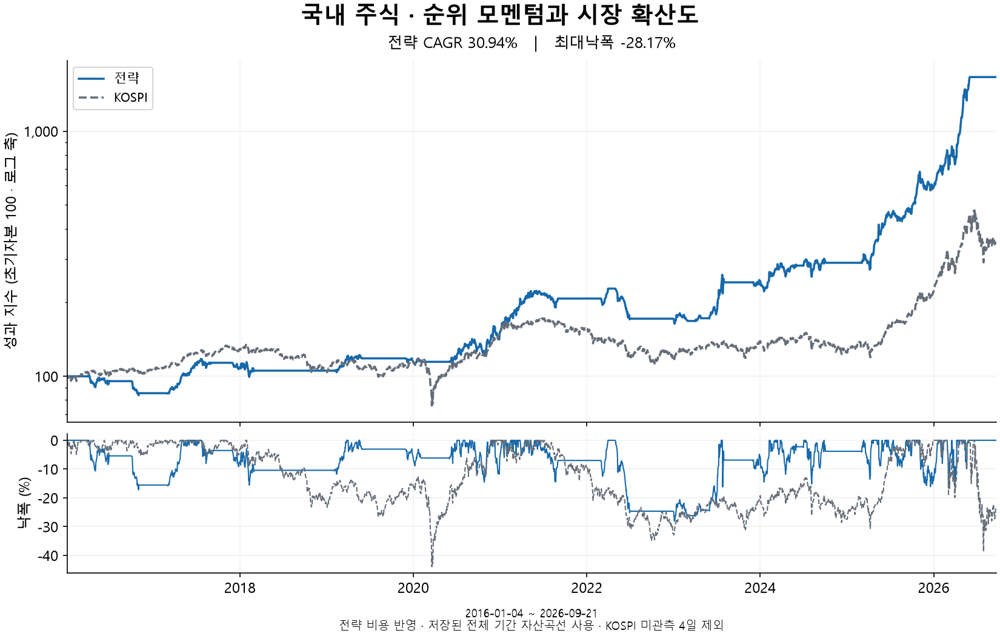
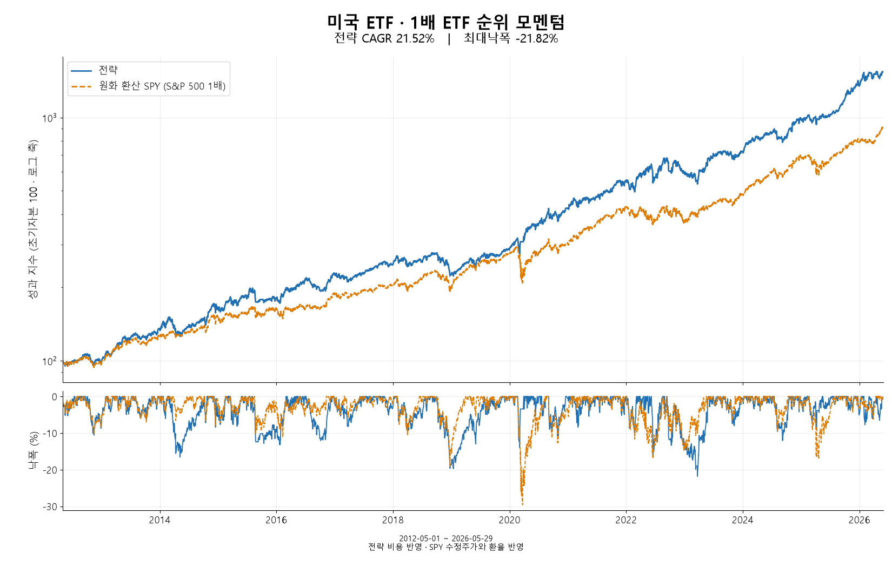
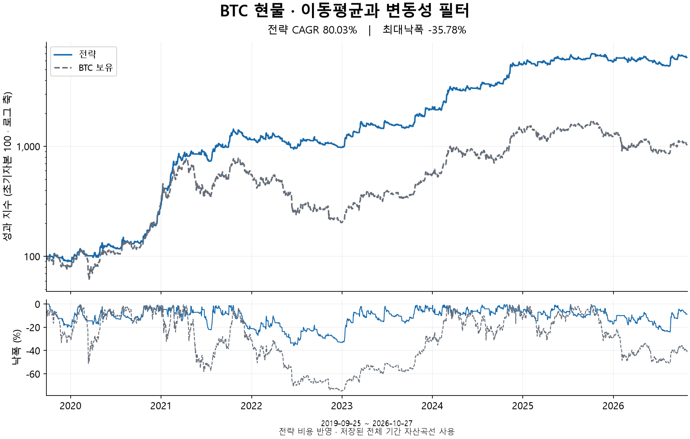
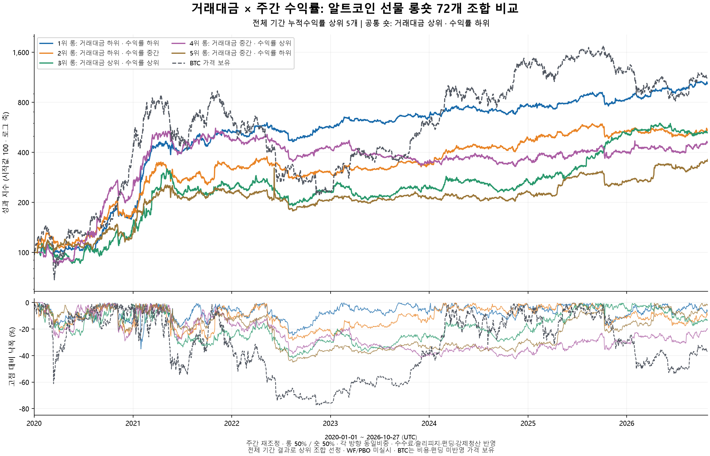
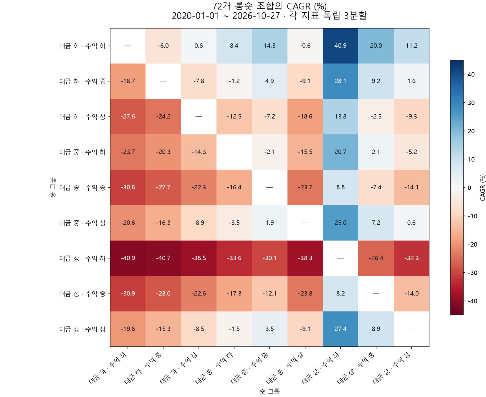

# 백테스트 사례 및 검증 보고서

## 1. 국내 주식 · 업종 내 순위 모멘텀

### 1.1 전략 명세

| 항목 | 설정 |
| --- | --- |
| 기간 | 2016-01-04 ~ 2026-09-21 |
| 유니버스 | KOSPI 보통주 · 전월 평균 시가총액 상위 100개 |
| 업종 기준 | 전월 말 업종 분류 · 동일 업종 3종목 이상 |
| 신호 계산 | 일별 수익률의 업종 내 백분위 → 월평균 |
| 모멘텀 | 12개월 중 최근 3개월 제외 · 이전 9개월 월평균 점수 합산 |
| 종목 선정 | 신호 상위 5개 · 업종당 최대 2개 |
| 비중·재조정 | 종목별 20% 동일비중 · 월별 |
| 체결 제약 | 거래량 없는 날 주문 연기 · 상장폐지분 마지막 유효 가격 정산 |
| 비용 | 수수료 0.15% · 슬리피지 0.10% |
| 설정 | [16개 후보 그리드](../configs/stocks/grid_kr_stock_kospi_common_avgmcap100_indpct_g3_rank9_18_skip0123_top5_indcap2_kospi200_benchmark_v2.json) |

### 1.2 백테스트 성과

<table width="100%">
  <tr>
    <td width="50%" valign="top"></td>
    <td width="50%" valign="top">
      <table width="100%">
        <tr><th align="left">지표</th><th align="right">전략</th><th align="right">KOSPI200</th></tr>
        <tr><td valign="top" align="left">누적수익률</td><td valign="top" align="right">2,685.08%</td><td valign="top" align="right">374.01%</td></tr>
        <tr><td valign="top" align="left">CAGR</td><td valign="top" align="right"><strong>37.61%</strong></td><td valign="top" align="right">16.09%</td></tr>
        <tr><td valign="top" align="left">MDD</td><td valign="top" align="right"><strong>-57.79%</strong></td><td valign="top" align="right">-41.19%</td></tr>
        <tr><td valign="top" align="left">Sharpe</td><td valign="top" align="right">1.22</td><td valign="top" align="right">0.72</td></tr>
        <tr><td valign="top" align="left">Calmar</td><td valign="top" align="right">0.65</td><td valign="top" align="right">0.39</td></tr>
        <tr><td valign="top" align="left">최장 회복기간</td><td valign="top" align="right">745거래일</td><td valign="top" align="right">—</td></tr>
        <tr><td valign="top" align="left">순손익 집중</td><td valign="top" align="right">SK하이닉스·SK스퀘어·삼성전자 합계 45.6%</td><td valign="top" align="right">—</td></tr>
      </table>
    </td>
  </tr>
</table>

### 1.3 검증 · 동일 기간 비교

| 검증 | 설정·결과 |
| --- | --- |
| 후보군 | 모멘텀 9·12·15·18개월 × 최근 제외 0·1·2·3개월 = 16개 |
| SPA | 5,000회 재표집 · **p=0.0246** |
| PBO | 12개월 구간 10개 · 양방향 252개 조합 · **19.44%** |
| WF | IS 24개월 · STEP 12개월 · OOS 12개월, 8개 적용 구간 · Rolling / Expanding |
| WF OOS | 2018-01-04 ~ 2026-01-02 |

**동일 기간 성과 (2018-01-04 ~ 2026-01-02 · 1,962거래일 · 달력일 연환산)**

| 방식 | CAGR | MDD | Sharpe |
| --- | ---: | ---: | ---: |
| 고정 설정: 12개월·3개월 제외 | 28.03% | -57.46% | 1.04 |
| WF Rolling | 18.13% | -56.56% | 0.76 |
| WF Expanding | 21.18% | -50.31% | 0.86 |
| KOSPI200 | 8.52% | -41.05% | 0.52 |

---

## 2. 미국 ETF · 상승월·추세 지속성

### 2.1 전략 명세

| 항목 | 설정 |
| --- | --- |
| 기간 | 2012-05-01 ~ 2026-05-29 |
| 유니버스 | 국가·산업·자산군별 미국 1배·2배 ETF 33개(고정 목록) |
| 순위 신호 | 일별 ETF 간 수익률 순위 → 월평균 → 12개월 중 최근 1개월 제외한 11개월 합산 |
| 절대 모멘텀 | 126거래일 수익률 > 0% |
| 상승월 조건 | 최근 20개월 중 상승월 11개월 이상 |
| 추세 지속성 | 252거래일 상승일 비율의 전월 평균 · ETF 간 하위 10% 제외 |
| 변동성 필터 | 10일 실현변동성의 252일 자기 백분위 ≤ 97.5% |
| 종목·비중 | 조건 통과 상위 최대 2개 · 2개면 각 50%, 1개면 100% |
| 재조정·비용 | 선정 종목 변경 시 · 수수료 0.05% · 슬리피지 0% |
| 설정 | [상승월 9개 후보·SSO 비교](../configs/stocks/grid_us_etf_positive_month_numeric9_sso_benchmark_v2.json) |

### 2.2 백테스트 성과

<table width="100%">
  <tr>
    <td width="50%" valign="top"></td>
    <td width="50%" valign="top">
      <table width="100%">
        <tr><th align="left">지표</th><th align="right">전략</th><th align="right">원화 환산 SSO</th></tr>
        <tr><td valign="top" align="left">누적수익률</td><td valign="top" align="right">7,529.52%</td><td valign="top" align="right">2,652.78%</td></tr>
        <tr><td valign="top" align="left">CAGR</td><td valign="top" align="right"><strong>36.16%</strong></td><td valign="top" align="right">26.63%</td></tr>
        <tr><td valign="top" align="left">MDD</td><td valign="top" align="right"><strong>-32.15%</strong></td><td valign="top" align="right">-56.74%</td></tr>
        <tr><td valign="top" align="left">Sharpe</td><td valign="top" align="right">1.14</td><td valign="top" align="right">0.88</td></tr>
        <tr><td valign="top" align="left">Calmar</td><td valign="top" align="right">1.12</td><td valign="top" align="right">0.47</td></tr>
        <tr><td valign="top" align="left">최장 회복기간</td><td valign="top" align="right">338거래일</td><td valign="top" align="right">—</td></tr>
      </table>
    </td>
  </tr>
</table>

**비교 기준:** SSO 수정주가를 기존 환율로 원화 환산 · SSO 보유 수익률에는 별도 거래 수수료 미반영.
### 2.3 검증 · 동일 기간 비교

| 검증 | 설정·결과 |
| --- | --- |
| 후보군 | 상승월 기준 9개: 16개월(8·9·10개월), 20개월(10·11·12개월), 24개월(12·14·15개월) |
| SPA | SSO 대비 초과수익 · 5,000회 재표집 · **p=0.2508** |
| PBO | SSO 대비 AIR · 24개월 구간·2개 앵커 · 양방향 40개 조합 · **10.00%** |
| WF | SSO 대비 AIR로 후보 선택 · Rolling IS 24개월 · STEP/OOS 각 24개월 · 6개 적용 구간 |
| WF OOS | 2014-05-01 ~ 2026-04-30 |

**동일 기간 성과 (2014-05-01 ~ 2026-04-30 · 3,018거래일)**

| 방식 | CAGR | MDD | Sharpe |
| --- | ---: | ---: | ---: |
| 고정 설정: 20개월 중 상승월 11개월 | 35.86% | -32.15% | 1.13 |
| WF Rolling | 32.86% | -32.15% | 1.06 |
| 원화 환산 SSO | 24.94% | -56.74% | 0.82 |

---

## 3. BTC 현물 · 이동평균·변동성 필터

### 3.1 전략 명세

| 항목 | 설정 |
| --- | --- |
| 기간 | 2019-09-25 03:00 ~ 2026-10-27 05:00 UTC |
| 유니버스·주기 | KRW-BTC · 1시간봉 |
| 추세 조건 | SMA 10시간 > SMA 120시간 |
| 변동성 측정 | 최근 240시간 로그수익률 표준편차 |
| 변동성 필터 | 최근 17,520시간(약 2년) 자기 분포의 95백분위 이하 |
| 비중 | 추세·변동성 조건 충족 시 BTC 100% · 미충족 시 현금 100% |
| 신호·체결 | 매시간 종가 기준 계산 · 다음 시간봉 시가 반영 |
| 비용 | 수수료 0.05% · 슬리피지 0% |
| 설정 | [SMA·변동성 27개 후보 그리드](../configs/grid_btc_sma_rv240_27_v2.json) |

### 3.2 백테스트 성과

<table width="100%">
  <tr>
    <td width="50%" valign="top"></td>
    <td width="50%" valign="top">
      <table width="100%">
        <tr><th align="left">지표</th><th align="right">전략</th><th align="right">BTC 보유</th></tr>
        <tr><td valign="top" align="left">누적수익률</td><td valign="top" align="right">6,333.00%</td><td valign="top" align="right">924.93%</td></tr>
        <tr><td valign="top" align="left">CAGR</td><td valign="top" align="right"><strong>80.03%</strong></td><td valign="top" align="right">38.90%</td></tr>
        <tr><td valign="top" align="left">MDD</td><td valign="top" align="right"><strong>-35.78%</strong></td><td valign="top" align="right">-74.85%</td></tr>
        <tr><td valign="top" align="left">Sharpe</td><td valign="top" align="right">1.91</td><td valign="top" align="right">0.88</td></tr>
        <tr><td valign="top" align="left">Calmar</td><td valign="top" align="right">2.24</td><td valign="top" align="right">0.52</td></tr>
        <tr><td valign="top" align="left">최장 회복기간</td><td valign="top" align="right">12,224시간</td><td valign="top" align="right">—</td></tr>
      </table>
    </td>
  </tr>
</table>

### 3.3 검증 · 동일 기간 비교

| 검증 | 설정·결과 |
| --- | --- |
| 후보군 | 단기 SMA 5·10·20시간 × 장기 SMA 60·120·240시간 × 변동성 기준 90·95·97.5백분위 = 27개 |
| SPA | Stationary bootstrap 3,000회 · **p=0.2627** |
| PBO | 6개월 구간·2개 앵커 · 양방향 4,356개 조합 · **32.99%** |
| WF | Rolling IS 24개월 · STEP/OOS 각 12개월 · 5개 적용 구간 |
| WF OOS | 2021-09-25 03:00 ~ 2026-09-25 02:00 UTC |

**동일 기간 성과 (2021-09-25 ~ 2026-09-25 · 43,753시간봉)**

| 방식 | CAGR | MDD | Sharpe |
| --- | ---: | ---: | ---: |
| 고정 설정: SMA 10·120시간·95백분위 | 47.01% | -35.78% | 1.47 |
| WF Rolling | 35.56% | -36.28% | 1.20 |
| BTC 보유 | 17.47% | -74.85% | 0.58 |

---

## 4. 알트코인 선물 · 거래대금×주간 수익률 롱·숏

### 4.1 전략 명세

| 항목 | 설정 |
| --- | --- |
| 기간·주기 | 2020-01-01 ~ 2026-10-27 UTC · 1시간봉 |
| 유니버스 | BTC 제외 바이낸스 USDT 무기한 선물 · 계약·주문 규칙 및 시점별 데이터 조건 충족 종목 |
| 거래대금 신호 | 직전 완료된 UTC 일봉 7개의 USDT 거래대금 합계 |
| 수익률 신호 | 직전 완료된 UTC 일봉 종가 기준 7일 누적수익률 |
| 그룹 구성 | 두 지표를 각각 종목 간 3분위로 분할 → 교차 9개 그룹 |
| 조합 | 롱 9개 그룹 × 서로 다른 숏 8개 그룹 = 72개 |
| 목표 비중 | 롱 50% · 숏 50% · 방향별 종목 동일비중 · 빈 그룹 몫 현금 |
| 재조정 | 매주 월요일 00:00 UTC · 다음 재조정까지 체결 수량 유지 |
| 포지션 | 목표 총 명목노출 100% · 격리증거금 · 거래소 증거금 레버리지 2배 |
| 비용·위험 | 수수료 0.05% · 슬리피지 0.02% · 펀딩·마크가격 OHLC 강제청산 |

### 4.2 백테스트 성과

<table width="100%">
  <tr>
    <td width="50%" valign="top"></td>
    <td width="50%" valign="top">
      <strong>1~5위 숏 그룹: 거래대금 상위 / 수익률 하위</strong> 
      <table width="100%">
        <tr><th align="left">순위 · 롱 그룹</th><th align="right">CAGR</th><th align="right">MDD</th><th align="right">Sharpe</th></tr>
        <tr><td valign="top" align="left">1 · 하위 / 하위</td><td valign="top" align="right"><strong>40.88%</strong></td><td valign="top" align="right">-35.05%</td><td valign="top" align="right">1.32</td></tr>
        <tr><td valign="top" align="left">2 · 하위 / 중간</td><td valign="top" align="right">28.14%</td><td valign="top" align="right">-29.19%</td><td valign="top" align="right">1.11</td></tr>
        <tr><td valign="top" align="left">3 · 상위 / 상위</td><td valign="top" align="right">27.44%</td><td valign="top" align="right">-41.91%</td><td valign="top" align="right">1.00</td></tr>
        <tr><td valign="top" align="left">4 · 중간 / 상위</td><td valign="top" align="right">25.00%</td><td valign="top" align="right">-42.57%</td><td valign="top" align="right">0.92</td></tr>
        <tr><td valign="top" align="left">5 · 중간 / 하위</td><td valign="top" align="right">20.74%</td><td valign="top" align="right">-44.99%</td><td valign="top" align="right">0.83</td></tr>
        <tr><td valign="top" align="left">비교 · BTC 보유</td><td valign="top" align="right">42.55%</td><td valign="top" align="right">-77.24%</td><td valign="top" align="right">0.89</td></tr>
      </table>
    </td>
  </tr>
</table>

### 4.3 조합 평가 · 주요 특성

| 항목 | 결과 |
| --- | --- |
| 선정 방식 | 전체 기간 누적수익률 1위 조합(사후 선정) · 누적수익률 **938.12%** |
| 조합 분포 | 72개 중 누적수익률 양수 22개 |
| 공통 숏 그룹 | 거래대금 상위·수익률 하위 숏을 쓴 8개 조합 모두 양수 · CAGR 8.18~40.88% |
| 연도별 특성 | 1위 조합 2021년 +219.25% · 2022년 +9.29% · 2025년 +6.89% |
| 유니버스 변화 | 실제 평균 보유 종목 수: 2020년 7.1개 → 2026년 115.1개 |
| 수익 구성 | 초기자금 10,000 USDT · 롱 55,320.01 / 숏 38,491.71 USDT 순이익 기여 |
| 종목 집중 | DOGE·OMG가 전체 순이익의 13.57% · 상위 5종목 27.49% |
| 검증 범위 | 72개 전체 기간 비교 · 연도별 성과·종목 집중도 평가 |
| 계약 기준 | 2026-11-02 계약 규칙 스냅샷 |
| 데이터 가정 | 누락 펀딩 직전 관측값 대체 · 가격 충돌·필수 가격 누락 종목 제외 |
| 청산·상폐 | 마크가격 OHLC 강제청산 · 상폐 마지막 유효 시가 · 격리담보 초과손실 보전 기록 |

---

**검증 지표:** [SPA·PBO·Walk-Forward 계산 규칙](config_reference_v2.md#vectorbt-spec)
