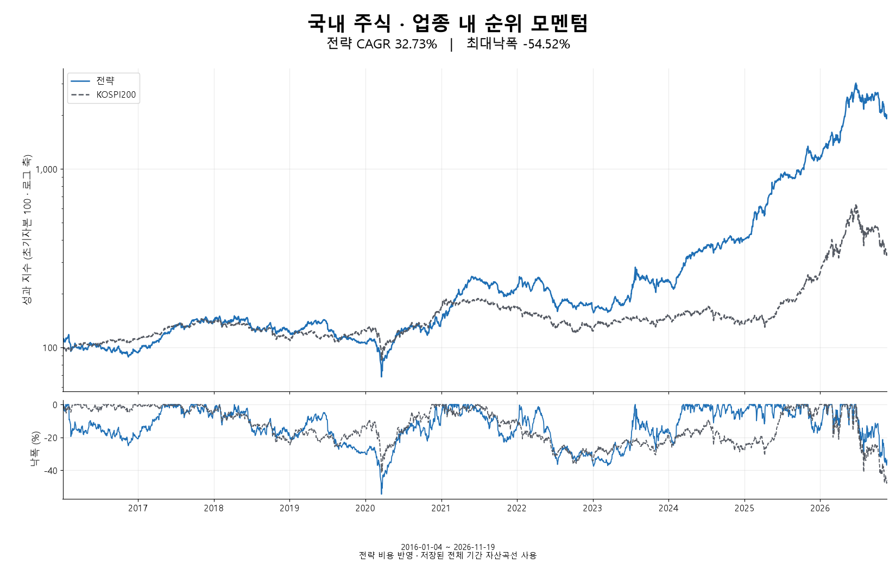
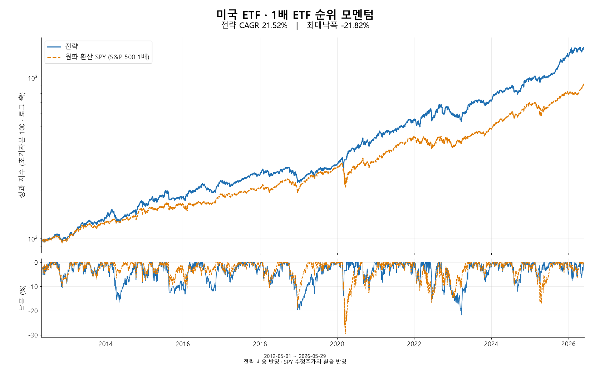
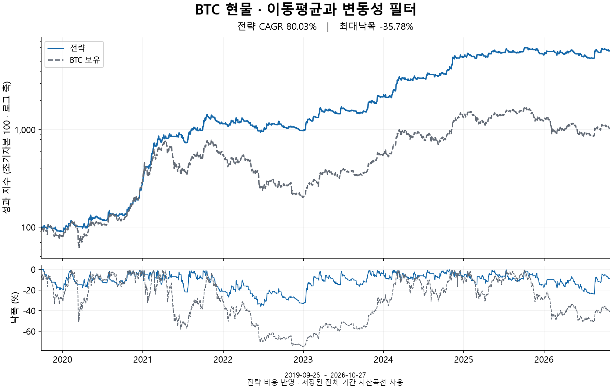
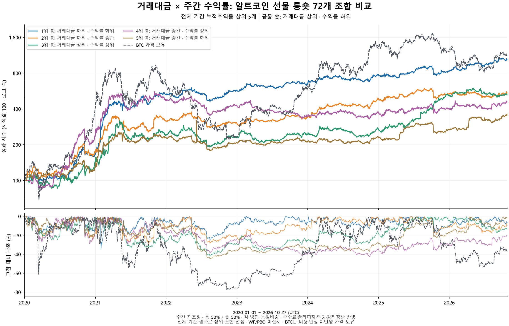
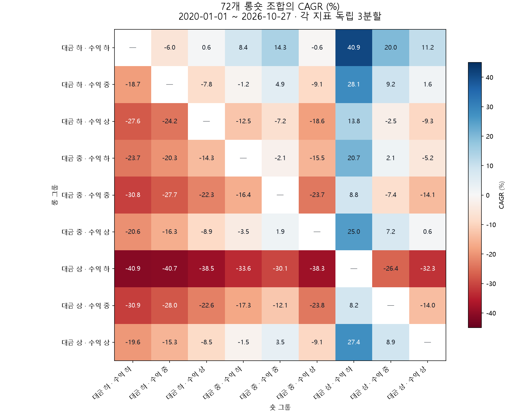

# 백테스트 사례 및 검증 보고서

## 1. 국내 주식 · 업종 내 순위 모멘텀

### 1.1 전략 명세

| 항목 | 설정 |
| --- | --- |
| 기간 | 2016-01-04 ~ 2026-11-19 |
| 가격 데이터 | KRX 정규장 종가 · KRX 기준가 수정계수 반영 · 상장폐지 종목 포함 |
| 유니버스 | KOSPI 보통주 · 전월 평균 시가총액 상위 100개 |
| 업종 기준 | 전월 말 업종 분류 · 동일 업종 3종목 이상 |
| 신호 계산 | 일별 수익률의 업종 내 백분위 → 월평균 |
| 모멘텀 | 12개월 중 최근 3개월 제외 · 이전 9개월 월평균 점수 합산 |
| 종목 선정 | 신호 상위 5개 · 업종당 최대 2개 |
| 비중·재조정 | 종목별 20% 동일비중 · 월별 |
| 체결 제약 | 거래량 없는 날 주문 연기 · 상장폐지분 마지막 유효 가격 정산 |
| 비용 | 수수료 0.15% · 슬리피지 0.10% |
| 설정 | [16개 후보 그리드](../configs/stocks/grid_kr_stock_kospi_common_avgmcap100_indpct_g3_rank9_18_skip0123_top5_indcap2_kospi200_benchmark_v2.json) |

### 1.2 백테스트 성과

<table width="100%">
  <tr>
    <td width="50%" rowspan="10" valign="top"></td>
    <th width="16%" align="left">지표</th><th width="17%" align="right">전략</th><th width="17%" align="right">KOSPI200</th>
  </tr>
  <tr><td align="left" valign="top">누적수익률</td><td align="right" valign="top">1,904.74%</td><td align="right" valign="top">240.78%</td></tr>
  <tr><td align="left" valign="top">CAGR</td><td align="right" valign="top"><strong>32.73%</strong></td><td align="right" valign="top">12.28%</td></tr>
  <tr><td align="left" valign="top">MDD</td><td align="right" valign="top"><strong>-54.52%</strong></td><td align="right" valign="top">-47.82%</td></tr>
  <tr><td align="left" valign="top">연환산 변동성</td><td align="right" valign="top">30.50%</td><td align="right" valign="top">25.65%</td></tr>
  <tr><td align="left" valign="top">Sharpe</td><td align="right" valign="top">1.01</td><td align="right" valign="top">0.50</td></tr>
  <tr><td align="left" valign="top">Calmar</td><td align="right" valign="top">0.60</td><td align="right" valign="top">0.26</td></tr>
  <tr><td align="left" valign="top">정보비율(IR)</td><td align="right" valign="top">0.80</td><td align="right" valign="top">—</td></tr>
  <tr><td align="left" valign="top">최장 회복기간</td><td align="right" valign="top">675거래일</td><td align="right" valign="top">—</td></tr>
  <tr><td align="left" valign="top">순손익 집중</td><td align="right" valign="top">SK스퀘어·SK하이닉스·효성중공업 합계 65.5%</td><td align="right" valign="top">—</td></tr>
</table>

**지표 산출 기준:** 국내 주식·미국 ETF는 일봉 연 252개, BTC 현물은 1시간봉 연 8,760개 수익률 관측치로 CAGR·변동성·Sharpe·IR을 연환산했다. 전체 기간 성과와 Walk-Forward OOS에도 같은 연환산 계수를 사용한다. 동일 기간 비교표의 고정 설정·벤치마크는 비교 구간 첫 관측값을 기준으로 계산했고, Walk-Forward Rolling·Expanding은 초기자금을 기준으로 첫 봉 진입 비용까지 반영한 OOS 성과다. Sharpe는 무위험수익률을 뺀 초과수익 기준이며, 국내 주식·미국 ETF·BTC 현물은 원화 수익률이므로 원화 CD 91일물(한국은행 ECOS), 알트코인 선물은 USDT 수익률이므로 미국 3개월 국채(FRED DTB3)를 쓴다. IR은 벤치마크 대비 일별 초과수익의 평균을 표준편차로 나눠 연환산한 값이다.

### 1.3 검증 · 동일 기간 비교

| 검증 | 설정·결과 |
| --- | --- |
| 후보군 | 모멘텀 9·12·15·18개월 × 최근 제외 0·1·2·3개월 = 16개 |
| SPA | 5,000회 재표집 · **p=0.0272** |
| PBO | 12개월 구간 10개 · 양방향 252개 조합 · **15.08%** |
| WF | IS 24개월 · STEP 12개월 · OOS 12개월, 8개 적용 구간 · Rolling / Expanding |
| WF OOS | 2018-01-04 ~ 2026-01-02 |

**동일 기간 성과 (2018-01-04 ~ 2026-01-02 · 1,962거래일 · 252거래일 연환산)**

| 방식 | CAGR | MDD | Sharpe |
| --- | ---: | ---: | ---: |
| 고정 설정: 12개월·3개월 제외 | 30.94% | -54.52% | 1.01 |
| WF Rolling | 20.19% | -64.55% | 0.70 |
| WF Expanding | 21.94% | -58.86% | 0.74 |
| KOSPI200 | 8.77% | -41.05% | 0.41 |

---

## 2. 미국 ETF · 1배 ETF 순위 모멘텀

### 2.1 전략 명세

| 항목 | 설정 |
| --- | --- |
| 기간 | 2012-05-01 ~ 2026-05-29 |
| 유니버스 | 미국 1배 ETF 17개(고정 목록): 섹터 12개(IYW·IYE·IYF·IYR·IYH·IYM·IYC·IYK·IDU·IYJ·IBB·IYZ), 국가·규모 3개(EEM·EWJ·IWM), 금·장기채(GLD·TLT) |
| 순위 신호 | 일별 ETF 간 수익률 순위 → 월평균 → 12개월 중 최근 1개월 제외한 11개월 합산 |
| 절대 모멘텀 | 126거래일 수익률 > 0% |
| 상승월 조건 | 최근 20개월 중 상승월 11개월 이상 |
| 추세 지속성 | 252거래일 상승일 비율의 전월 평균 · ETF 간 하위 10% 제외 |
| 변동성 필터 | 10일 실현변동성의 252일 자기 백분위 ≤ 97.5% |
| 종목·비중 | 조건 통과 상위 최대 2개 · 2개면 각 50%, 1개면 100% |
| 재조정·비용 | 선정 종목 변경 시 · 수수료 0.05% · 슬리피지 0% |
| 설정 | [1배 ETF 36개 후보 그리드](../configs/stocks/grid_us_etf_1x_sector17_rank_absmom_topn_spy_benchmark_v2.json) |

### 2.2 백테스트 성과

<table width="100%">
  <tr>
    <td width="50%" rowspan="9" valign="top"></td>
    <th width="16%" align="left">지표</th><th width="17%" align="right">전략</th><th width="17%" align="right">원화 환산 SPY</th>
  </tr>
  <tr><td align="left" valign="top">누적수익률</td><td align="right" valign="top">1,442.80%</td><td align="right" valign="top">815.76%</td></tr>
  <tr><td align="left" valign="top">CAGR</td><td align="right" valign="top"><strong>21.50%</strong></td><td align="right" valign="top">17.08%</td></tr>
  <tr><td align="left" valign="top">MDD</td><td align="right" valign="top"><strong>-21.82%</strong></td><td align="right" valign="top">-29.62%</td></tr>
  <tr><td align="left" valign="top">연환산 변동성</td><td align="right" valign="top">17.72%</td><td align="right" valign="top">17.34%</td></tr>
  <tr><td align="left" valign="top">Sharpe</td><td align="right" valign="top">1.07</td><td align="right" valign="top">0.87</td></tr>
  <tr><td align="left" valign="top">Calmar</td><td align="right" valign="top">0.99</td><td align="right" valign="top">0.58</td></tr>
  <tr><td align="left" valign="top">정보비율(IR)</td><td align="right" valign="top">0.27</td><td align="right" valign="top">—</td></tr>
  <tr><td align="left" valign="top">최장 회복기간</td><td align="right" valign="top">301거래일</td><td align="right" valign="top">—</td></tr>
</table>

**비교 기준:** SPY 수정주가를 기존 환율로 원화 환산(VOO와 같은 S&P 500 추종) · SPY 보유 수익률에는 별도 거래 수수료 미반영.

### 2.3 검증 · 동일 기간 비교

| 검증 | 설정·결과 |
| --- | --- |
| 후보군 | 모멘텀 9·12·15개월 × 절대 모멘텀 63·126·252일 × 종목 수 1·2·3·5개 = 36개 (상승월·추세 조건 고정) |
| SPA | SPY 대비 초과수익 · 5,000회 재표집 · **p=0.2302** |
| PBO | SPY 대비 AIR · 24개월 구간·2개 앵커 · 양방향 40개 조합 · **7.50%** |
| WF | SPY 대비 AIR로 후보 선택 · IS 24개월(Rolling은 이동, Expanding은 시작 고정) · STEP/OOS 각 24개월 · 6개 적용 구간 |
| WF OOS | 2014-05-01 ~ 2026-04-30 |

SPA p값은 0.05를 넘어 SPY 대비 초과성과의 통계적 유의성은 확인되지 않았고, 36개 후보 중 정보비율이 양수인 후보는 18개다.

**동일 기간 성과 (2014-05-01 ~ 2026-04-30 · 3,018거래일 · 252거래일 연환산)**

| 방식 | CAGR | MDD | Sharpe |
| --- | ---: | ---: | ---: |
| 고정 설정: 12개월·절대 모멘텀 126일·2종목 | 22.46% | -21.82% | 1.10 |
| WF Rolling | 23.84% | -23.55% | 1.06 |
| WF Expanding | 19.10% | -24.82% | 0.88 |
| 원화 환산 SPY | 17.21% | -29.62% | 0.86 |

---

## 3. BTC 현물 · 이동평균·변동성 필터

### 3.1 전략 명세

| 항목 | 설정 |
| --- | --- |
| 기간 | 2019-09-25 03:00 ~ 2026-10-27 05:00 UTC |
| 유니버스·주기 | KRW-BTC · 1시간봉 |
| 추세 조건 | SMA 10시간 > SMA 120시간 |
| 변동성 측정 | 최근 240시간 로그수익률 표준편차 |
| 변동성 필터 | 최근 17,520시간(약 2년) 자기 분포의 95백분위 이하 |
| 비중 | 추세·변동성 조건 충족 시 BTC 100% · 미충족 시 현금 100% |
| 신호·체결 | 매시간 종가 기준 계산 · 다음 시간봉 시가 반영 |
| 비용 | 수수료 0.05% · 슬리피지 0% |
| 설정 | [SMA·변동성 27개 후보 그리드](../configs/grid_btc_sma_rv240_27_v2.json) |

### 3.2 백테스트 성과

<table width="100%">
  <tr>
    <td width="50%" rowspan="9" valign="top"></td>
    <th width="16%" align="left">지표</th><th width="17%" align="right">전략</th><th width="17%" align="right">BTC 보유</th>
  </tr>
  <tr><td align="left" valign="top">누적수익률</td><td align="right" valign="top">6,333.00%</td><td align="right" valign="top">924.93%</td></tr>
  <tr><td align="left" valign="top">CAGR</td><td align="right" valign="top"><strong>80.03%</strong></td><td align="right" valign="top">38.90%</td></tr>
  <tr><td align="left" valign="top">MDD</td><td align="right" valign="top"><strong>-35.78%</strong></td><td align="right" valign="top">-74.85%</td></tr>
  <tr><td align="left" valign="top">연환산 변동성</td><td align="right" valign="top">33.77%</td><td align="right" valign="top">53.38%</td></tr>
  <tr><td align="left" valign="top">Sharpe</td><td align="right" valign="top">1.84</td><td align="right" valign="top">0.84</td></tr>
  <tr><td align="left" valign="top">Calmar</td><td align="right" valign="top">2.24</td><td align="right" valign="top">0.52</td></tr>
  <tr><td align="left" valign="top">정보비율(IR)</td><td align="right" valign="top">0.42</td><td align="right" valign="top">—</td></tr>
  <tr><td align="left" valign="top">최장 회복기간</td><td align="right" valign="top">12,224시간</td><td align="right" valign="top">—</td></tr>
</table>

### 3.3 검증 · 동일 기간 비교

| 검증 | 설정·결과 |
| --- | --- |
| 후보군 | 단기 SMA 5·10·20시간 × 장기 SMA 60·120·240시간 × 변동성 기준 90·95·97.5백분위 = 27개 |
| SPA | Stationary bootstrap 3,000회 · **p=0.2627** |
| PBO | 6개월 구간·2개 앵커 · 양방향 4,356개 조합 · **32.99%** |
| WF | IS 24개월(Rolling은 이동, Expanding은 시작 고정) · STEP/OOS 각 12개월 · 5개 적용 구간 |
| WF OOS | 2021-09-25 03:00 ~ 2026-09-25 02:00 UTC |

**동일 기간 성과 (2021-09-25 ~ 2026-09-25 · 43,753시간봉)**

| 방식 | CAGR | MDD | Sharpe |
| --- | ---: | ---: | ---: |
| 고정 설정: SMA 10·120시간·95백분위 | 47.01% | -35.78% | 1.37 |
| WF Rolling | 35.53% | -36.28% | 1.10 |
| WF Expanding | 40.72% | -36.28% | 1.21 |
| BTC 보유 | 17.47% | -74.85% | 0.52 |

---

## 4. 알트코인 선물 · 거래대금×주간 수익률 롱·숏

### 4.1 전략 명세

| 항목 | 설정 |
| --- | --- |
| 기간·주기 | 2020-01-01 ~ 2026-10-27 UTC · 1시간봉 |
| 유니버스 | BTC 제외 바이낸스 USDT 무기한 선물 · 해당 시점의 가격·거래대금 데이터를 이용할 수 있는 종목 |
| 거래대금 신호 | 직전 완료된 UTC 일봉 7개의 USDT 거래대금 합계 |
| 수익률 신호 | 직전 완료된 UTC 일봉 종가 기준 7일 누적수익률 |
| 그룹 구성 | 두 지표를 각각 종목 간 3분위로 분할 → 교차 9개 그룹 |
| 조합 | 롱 9개 그룹 × 서로 다른 숏 8개 그룹 = 72개 |
| 목표 비중 | 롱 50% · 숏 50% · 방향별 종목 동일비중 · 빈 그룹 몫 현금 |
| 재조정 | 매주 월요일 00:00 UTC · 다음 재조정까지 체결 수량 유지 |
| 포지션 | 목표 총 명목노출 100% · 격리증거금 · 거래소 증거금 레버리지 2배 |
| 비용·위험 | 수수료 0.05% · 슬리피지 0.02% · 펀딩·마크가격 OHLC 강제청산 |

### 4.2 백테스트 성과

<table width="100%">
  <tr>
    <td width="50%" rowspan="8" valign="top"></td>
    <th width="18%" align="left">순위 · 롱 그룹</th><th width="8%" align="right">CAGR</th><th width="8%" align="right">MDD</th><th width="8%" align="right">변동성</th><th width="8%" align="right">Sharpe</th><th width="8%" align="right">IR(현금)</th><th width="8%" align="right">BTC 베타</th>
  </tr>
  <tr><td align="left" valign="top">1 · 하위 / 하위</td><td align="right" valign="top"><strong>40.88%</strong></td><td align="right" valign="top">-35.05%</td><td align="right" valign="top">29.23%</td><td align="right" valign="top">1.22</td><td align="right" valign="top">1.22</td><td align="right" valign="top">-0.04</td></tr>
  <tr><td align="left" valign="top">2 · 하위 / 중간</td><td align="right" valign="top">28.14%</td><td align="right" valign="top">-29.19%</td><td align="right" valign="top">25.13%</td><td align="right" valign="top">1.00</td><td align="right" valign="top">1.00</td><td align="right" valign="top">-0.04</td></tr>
  <tr><td align="left" valign="top">3 · 상위 / 상위</td><td align="right" valign="top">27.44%</td><td align="right" valign="top">-41.91%</td><td align="right" valign="top">28.39%</td><td align="right" valign="top">0.90</td><td align="right" valign="top">0.90</td><td align="right" valign="top">-0.02</td></tr>
  <tr><td align="left" valign="top">4 · 중간 / 상위</td><td align="right" valign="top">25.00%</td><td align="right" valign="top">-42.57%</td><td align="right" valign="top">28.94%</td><td align="right" valign="top">0.82</td><td align="right" valign="top">0.82</td><td align="right" valign="top">-0.04</td></tr>
  <tr><td align="left" valign="top">5 · 중간 / 하위</td><td align="right" valign="top">20.74%</td><td align="right" valign="top">-44.99%</td><td align="right" valign="top">27.05%</td><td align="right" valign="top">0.73</td><td align="right" valign="top">0.73</td><td align="right" valign="top">-0.02</td></tr>
  <tr><td align="left" valign="top">비교 · BTC 보유</td><td align="right" valign="top">42.55%</td><td align="right" valign="top">-77.24%</td><td align="right" valign="top">60.71%</td><td align="right" valign="top">0.84</td><td align="right" valign="top">—</td><td align="right" valign="top">—</td></tr>
  <tr><td colspan="7" align="left"><strong>1~5위 숏 그룹: 거래대금 상위 / 수익률 하위</strong></td></tr>
</table>

**벤치마크:** 롱·숏이 시장 방향을 상쇄하는 구조라 기준은 현금(미국 3개월 국채, FRED DTB3)이다. 현금 대비 IR은 무위험수익률을 뺀 Sharpe와 같은 정의이므로 두 열의 값이 같다. BTC 보유는 같은 기간 시장 비교용이며, BTC 베타는 1시간 수익률 기준 전략 수익률의 BTC 수익률에 대한 회귀계수다.

### 4.3 조합 평가 · 주요 특성

<table width="100%">
  <tr>
    <td width="50%" rowspan="8" valign="top"></td>
    <th width="15%" align="left" valign="top">선정 방식</th>
    <td width="35%" valign="top">전체 기간 누적수익률 1위 조합(사후 선정) · 누적수익률 <strong>938.12%</strong></td>
  </tr>
  <tr><th align="left" valign="top">조합 분포</th><td valign="top">72개 중 누적수익률 양수 22개</td></tr>
  <tr><th align="left" valign="top">공통 숏 그룹</th><td valign="top">거래대금 상위·수익률 하위 숏을 쓴 8개 조합 모두 양수 · CAGR 8.18~40.88%</td></tr>
  <tr><th align="left" valign="top">연도별 특성</th><td valign="top">1위 조합 2021년 +219.25% · 2022년 +9.29% · 2025년 +6.89%</td></tr>
  <tr><th align="left" valign="top">유니버스 변화</th><td valign="top">실제 평균 보유 종목 수: 2020년 7.1개 → 2026년 115.1개</td></tr>
  <tr><th align="left" valign="top">수익 구성</th><td valign="top">초기자금 10,000 USDT · 롱 55,320.01 / 숏 38,491.71 USDT 순이익 기여</td></tr>
  <tr><th align="left" valign="top">종목 집중</th><td valign="top">DOGE·OMG가 전체 순이익의 13.57% · 상위 5종목 27.49%</td></tr>
  <tr><th align="left" valign="top">검증 범위</th><td valign="top">72개 전체 기간 비교 · 연도별 성과·종목 집중도 평가</td></tr>
</table>

**데이터·체결 기준:** 시점별 확보된 가격·거래 데이터를 사용하며, 결측·거래 종료·청산은 사전에 정의한 연구용 처리 규칙을 적용했다. 계약 조건에는 거래소 규칙 스냅샷을 사용했다.

---

**검증 지표:** [SPA·PBO·Walk-Forward 계산 규칙](config_reference_v2.md#vectorbt-spec)
