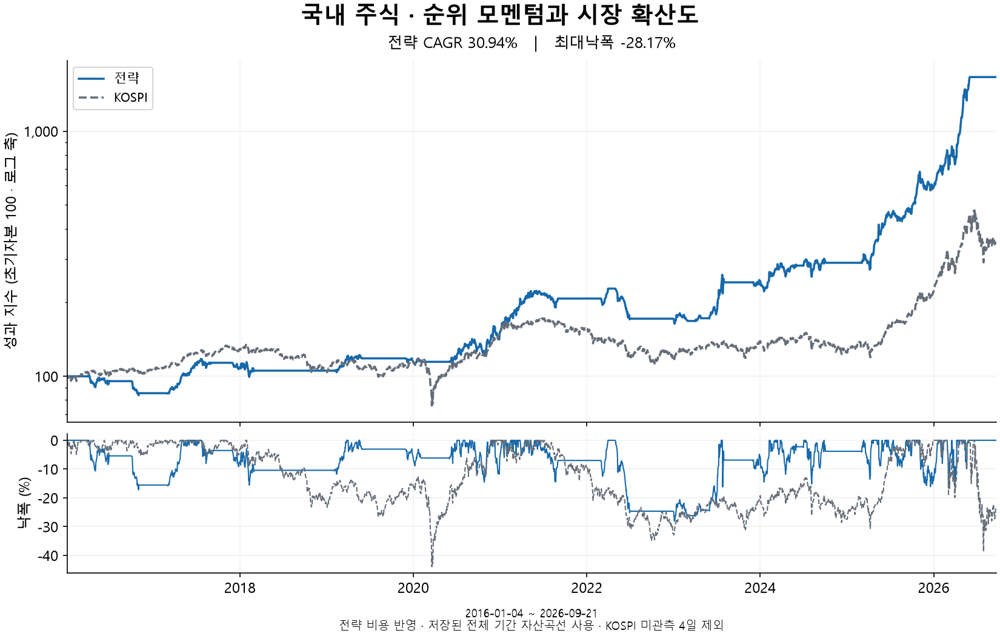
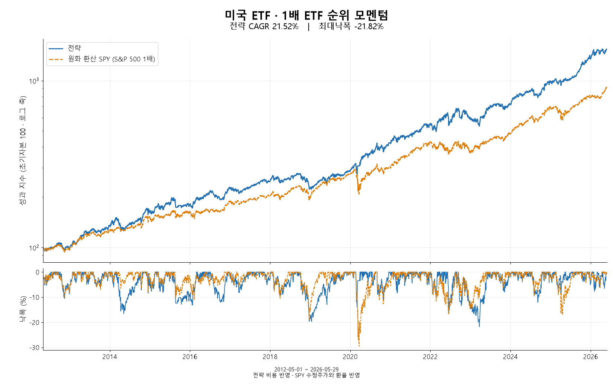
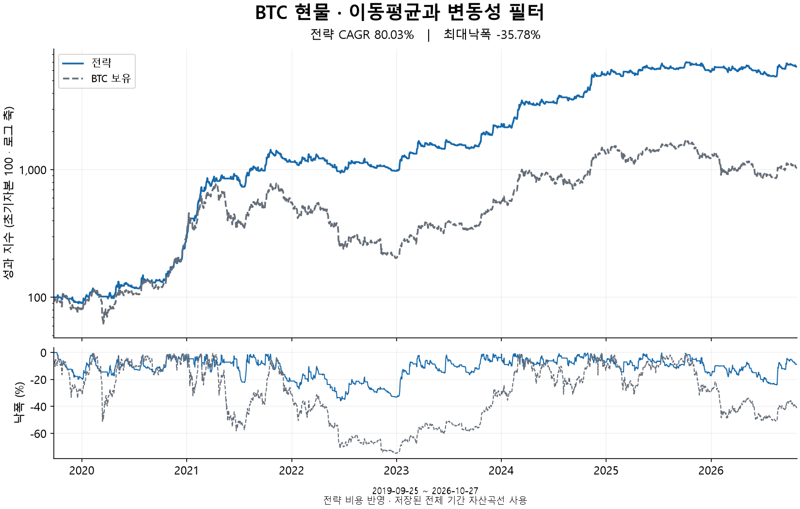
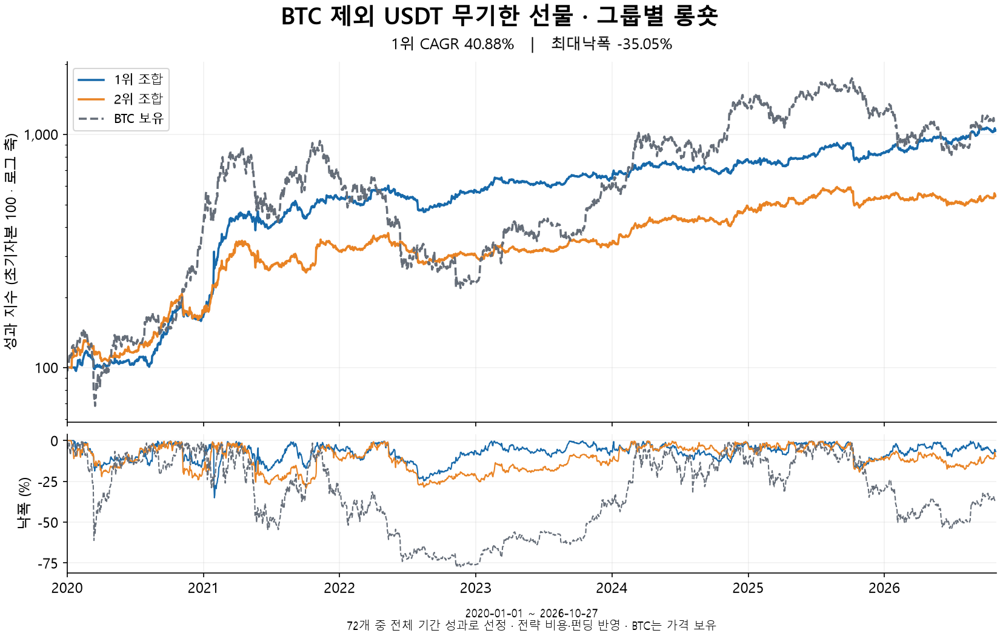

# 전략별 백테스트

## 국내 주식 · 업종 내 순위 모멘텀

<table>
  <tr>
    <td width="53%" valign="top">
      
    </td>
    <td width="47%" valign="top">
      <table>
        <tr><th align="left" valign="top" width="26%">유니버스</th><td valign="top">KOSPI 보통주 · 전월 평균 시가총액 상위 100개 전월 기준 업종 분류 · 업종 내 계산은 3종목 이상</td></tr>
        <tr><th align="left" valign="top" width="26%">신호·필터</th><td valign="top">업종 내 일별 수익률 백분위 → 월평균 → 최근 3개월 제외한 9개월 합산</td></tr>
        <tr><th align="left" valign="top" width="26%">종목·비중</th><td valign="top">점수 상위 5개 · 업종당 최대 2개 · 동일비중(각 20%)</td></tr>
        <tr><th align="left" valign="top" width="26%">운용·비용</th><td valign="top">월별 재조정 · 수수료 0.15% · 슬리피지 0.10%</td></tr>
        <tr><th align="left" valign="top" width="26%">전체 성과</th><td valign="top"><strong>CAGR 37.61% · MDD -57.79%</strong> Sharpe 1.22 · 2016.01–2026.09</td></tr>
        <tr><th align="left" valign="top" width="26%">벤치마크</th><td valign="top">KOSPI200 · CAGR 16.09% · MDD -41.19%</td></tr>
        <tr><th align="left" valign="top" width="26%">통계 검증</th><td valign="top">16개 후보(모멘텀 9·12·15·18개월 × 제외 0·1·2·3개월) SPA p=0.0246 · PBO 19.44%</td></tr>
        <tr><th align="left" valign="top" width="26%">WF</th><td valign="top">2018.01–2026.01 · Rolling CAGR 18.13% / MDD -56.56% Expanding CAGR 21.18% / MDD -50.31% 같은 기간 KOSPI200 CAGR 8.52%</td></tr>
      </table>
    </td>
  </tr>
</table>

## 미국 ETF · 상승월·추세 지속성

<table>
  <tr>
    <td width="53%" valign="top">
      
    </td>
    <td width="47%" valign="top">
      <table>
        <tr><th align="left" valign="top" width="26%">유니버스</th><td valign="top">미국 상장 1배·2배 ETF 33개 · 국가·산업·자산군별 고정 목록</td></tr>
        <tr><th align="left" valign="top" width="26%">신호·필터</th><td valign="top">12개월 중 최근 1개월 제외한 일별 횡단 순위의 월평균 합산 126거래일 수익률 &gt; 0 · 20개월 중 상승월 ≥ 11개 252일 상승일 비율 하위 10% 제외 · 10일 변동성 자체 252일 백분위 ≤ 97.5%</td></tr>
        <tr><th align="left" valign="top" width="26%">종목·비중</th><td valign="top">조건 통과 ETF 중 점수 상위 최대 2개 2개면 각 50% · 1개면 100%</td></tr>
        <tr><th align="left" valign="top" width="26%">운용·비용</th><td valign="top">선정 종목 변경 시 조정 · 수수료 0.05% · 슬리피지 0%</td></tr>
        <tr><th align="left" valign="top" width="26%">전체 성과</th><td valign="top"><strong>CAGR 36.16% · MDD -32.15%</strong> Sharpe 1.14 · 2012.05–2026.05</td></tr>
        <tr><th align="left" valign="top" width="26%">벤치마크</th><td valign="top">원화 환산 SSO · CAGR 26.63% · MDD -56.74%</td></tr>
        <tr><th align="left" valign="top" width="26%">통계 검증</th><td valign="top">상승월 조건 9개 후보 · SPA p=0.2508 · PBO 10.00%</td></tr>
        <tr><th align="left" valign="top" width="26%">WF</th><td valign="top">2014.05–2026.04 · CAGR 32.86% / MDD -32.15% 같은 기간 원화 환산 SSO CAGR 24.94%</td></tr>
      </table>
    </td>
  </tr>
</table>

## BTC 현물 · 이동평균·변동성

<table>
  <tr>
    <td width="53%" valign="top">
      
    </td>
    <td width="47%" valign="top">
      <table>
        <tr><th align="left" valign="top" width="26%">유니버스</th><td valign="top">KRW-BTC 현물 단일 자산 · 1시간봉</td></tr>
        <tr><th align="left" valign="top" width="26%">신호·필터</th><td valign="top">10시간 SMA &gt; 120시간 SMA 최근 240시간 변동성 ≤ 약 2년(17,520시간) 자기 분포 95백분위</td></tr>
        <tr><th align="left" valign="top" width="26%">종목·비중</th><td valign="top">두 조건 충족 시 BTC 100% · 그 외 현금 100%</td></tr>
        <tr><th align="left" valign="top" width="26%">운용·비용</th><td valign="top">매시간 신호 계산 → 다음 시간봉 시가 반영 수수료 0.05% · 슬리피지 0%</td></tr>
        <tr><th align="left" valign="top" width="26%">전체 성과</th><td valign="top"><strong>CAGR 80.03% · MDD -35.78%</strong> Sharpe 1.91 · 2019.09–2026.10</td></tr>
        <tr><th align="left" valign="top" width="26%">벤치마크</th><td valign="top">BTC 단순 보유 · CAGR 38.90% · MDD -74.85%</td></tr>
        <tr><th align="left" valign="top" width="26%">통계 검증</th><td valign="top">단기 SMA 3 × 장기 SMA 3 × 변동성 기준 3 = 27개 후보 SPA p=0.2627 · PBO 32.99%</td></tr>
        <tr><th align="left" valign="top" width="26%">WF</th><td valign="top">2021.09–2026.09 · CAGR 35.56% / MDD -36.28% 같은 기간 BTC 보유 CAGR 17.47%</td></tr>
      </table>
    </td>
  </tr>
</table>

## 알트코인 선물 · 거래대금×수익률 롱·숏

<table>
  <tr>
    <td width="53%" valign="top">
      
    </td>
    <td width="47%" valign="top">
      <table>
        <tr><th align="left" valign="top" width="26%">유니버스</th><td valign="top">바이낸스 USDT 무기한 선물(BTC 제외) 시점별 계약·주문 규칙과 거래 데이터 조건 충족 종목</td></tr>
        <tr><th align="left" valign="top" width="26%">신호·필터</th><td valign="top">직전 완료된 일봉 기준 7일 USDT 거래대금과 7일 수익률을 각각 3분위 → 9개 그룹</td></tr>
        <tr><th align="left" valign="top" width="26%">종목·비중</th><td valign="top">롱 9개 그룹 × 서로 다른 숏 8개 그룹 = 72개 조합 1위: 롱 거래대금 하위·수익률 하위 / 숏 거래대금 상위·수익률 하위 롱 50% · 숏 50%, 각 방향 동일비중</td></tr>
        <tr><th align="left" valign="top" width="26%">운용·비용</th><td valign="top">매주 월요일 00:00 UTC 재조정 수수료 0.05% · 슬리피지 0.02% · 펀딩·강제청산 반영</td></tr>
        <tr><th align="left" valign="top" width="26%">전체 성과</th><td valign="top"><strong>CAGR 40.88% · MDD -35.05%</strong> Sharpe 1.32 · 2020.01–2026.10 전체 기간 누적수익률 1위 조합</td></tr>
        <tr><th align="left" valign="top" width="26%">벤치마크</th><td valign="top">BTC 가격 보유 · CAGR 42.55% · MDD -77.24%</td></tr>
        <tr><th align="left" valign="top" width="26%">평가 범위</th><td valign="top">72개 조합 중 누적수익률 양수 22개 전체 기간 성과 순위로 조합 선정</td></tr>
        <tr><th align="left" valign="top" width="26%">자료</th><td valign="top"><a href="assets/alt_ls9_72_cagr_heatmap.png">72개 조합 CAGR 히트맵</a></td></tr>
      </table>
    </td>
  </tr>
</table>

[상세 전략·검증 보고서](strategy_examples.md)
