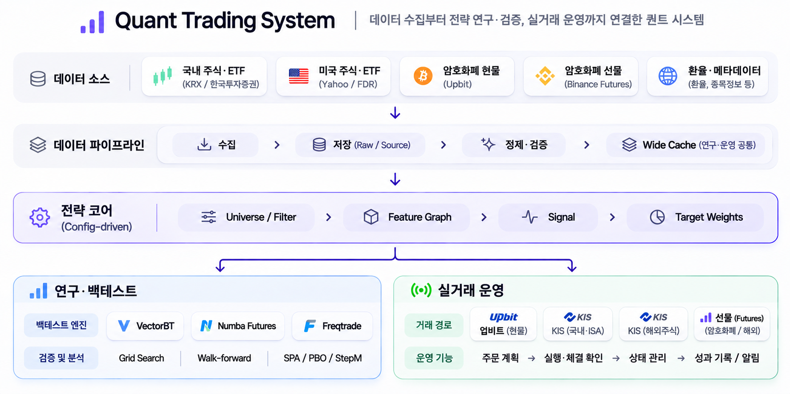
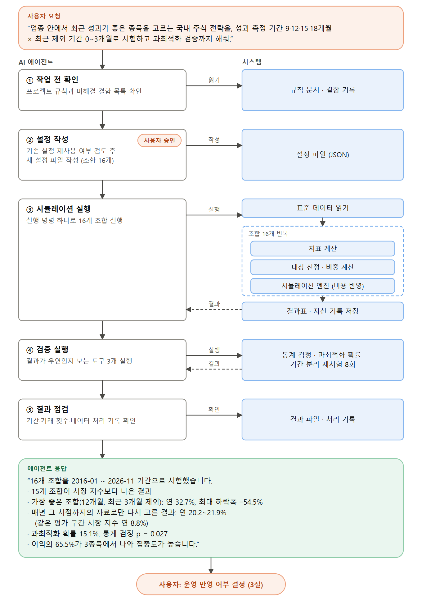

# 시스템 사용·운영 방식

외부 데이터를 모으고, 설정 파일에 정의한 규칙으로 판단하고, 그 판단을 계좌에서 실행하고, 결과를 기록하는 과정을 어떻게 사용하고 운영하는지 정리한 문서다. 기능별 구현 범위는 [기능 목록](feature_inventory.md), 설정 옵션은 [설정 레퍼런스](config_reference_v2.md)에 있다.

- 개발과 운영에 AI 코딩 에이전트를 사용하고, 수정 승인·결함 기록 규칙으로 작업을 통제함
- 정해진 시각에 자동 실행되는 작업 7개(실계좌 3개), 연결한 외부 데이터·거래 시스템 9곳, 자동 테스트 771개

## 1. 시스템 구성



| 구성 요소 | 하는 일 | 입력 | 출력 |
|---|---|---|---|
| 수집기 | 외부 시스템에서 주기적으로 데이터를 받아 저장. 빠진 구간은 다시 받고, 받은 이력을 기록 | 거래소·공공기관 API, 공식 파일 저장소 | 원천 자료 파일, 수집·누락·보충 기록 |
| 데이터 저장소 | 원천마다 다른 형식을 "시각 × 대상" 표준 표로 정리. 각 값에 실제로 알 수 있었던 시점을 붙임 | 원천 자료 | 모든 작업이 함께 쓰는 표준 데이터 파일 |
| 규칙 엔진 | 설정 파일에 적힌 대로 지표를 계산하고, 대상을 고르고, 배분 비율을 정함 | 표준 데이터, 설정 파일 | 시점별 대상별 목표 비율 |
| 시뮬레이터 | 과거 데이터로 규칙을 돌려 결과를 계산. 여러 설정을 자동으로 바꿔 가며 비교하고, 결과가 운인지 검증 | 목표 비율, 비용 조건 | 설정별 결과표, 시간별 자산 기록, 검증 보고서 |
| 실행기 | 정해진 시각에 현재 계좌를 조회하고 목표와의 차이만큼 주문. 처리 결과를 확인하고 기록·알림 | 목표 비율, 계좌 잔고 | 주문·체결 기록, 상태 파일, 계좌 기록, 알림 |

- **연구와 운영이 같은 코드 사용:** 실행기는 시뮬레이터와 같은 설정 파일·규칙 엔진으로 목표를 계산함. 시험한 규칙과 실제로 실행되는 규칙이 달라지지 않음
- **설정 파일 중심:** 단일 시험, 설정 비교, 자동 탐색, 검증, 운영이 같은 형식의 설정을 읽음

## 2. 사용 방식

### 2.1 설정 파일

규칙은 블록 6개로 나누어 정의함. 아래 값은 2.2의 시험에 쓴 설정.

| 블록 | 정의하는 내용 | 2.2 시험의 값 |
|---|---|---|
| 데이터 위치 | 읽을 표준 데이터, 결과 저장 위치 | 국내 주식 일별 데이터 |
| 지표 정의 | 원천 값에서 출발해 계산 단계를 차례로 적용. 단계 간 참조 관계는 자동 분석 | 일별 수익률 → 업종 내 순위 → 월평균 → 기간 합산 |
| 대상 선정 | 어떤 지표로 몇 개를 고를지, 제외 조건 | 상위 5종목, 업종당 최대 2개 |
| 비중 | 배분 방식, 재조정 주기 | 동일 비중, 월 1회 |
| 실행 조건 | 수수료, 체결 가격 차이, 비교 기준 | 수수료 0.15%, 가격 차이 0.10%, KOSPI200 |
| 조합 | 바꿔 가며 시험할 값과 제약 | 4 × 4 = 16개 |

```json
"grid": { "rank_months": [9, 12, 15, 18], "skip_months": [0, 1, 2, 3] },
"constraints": [ "rank_months > skip_months" ],
"weight_spec_template": { "weighting": "equal", "rebalance_frequency": "monthly" }
```

- 조합 값을 늘리거나 탐색 방식을 전수·무작위·자동 탐색(TPE) 중에서 바꾸는 것도 설정으로 지정함. 자동 탐색은 시도 이력을 SQLite에 저장해 중단 후 이어서 실행

### 2.2 백테스트 작업 흐름

사용자가 자연어로 요청하면 AI 에이전트가 설정 파일을 만들고 시스템을 실행한 뒤, 결과를 점검해 보고함. 아래는 그 흐름을 요청 한 번과 응답 한 번으로 정리한 예시이며, 응답의 수치는 2.1의 설정으로 실행한 결과임.



- 사용자는 요청, 설정 작성 승인, 운영 반영 결정을 맡음

### 2.3 결과물과 검증

- **결과표:** 조합별 수익률, 최대 하락폭, 변동성, 비교 기준 대비 지표, 거래 횟수
- **자산 기록:** 조합별·시점별 자산 가치와 비교 기준 값
- **검증 보고서:** 여러 조합 중 가장 좋은 것을 고르면 그 결과에는 운이 섞임. 이를 세 방법으로 따로 측정함
  - 통계 검정(SPA): 여러 조합을 시험한 효과를 감안해도 초과 성과가 우연이 아닌지
  - 과최적화 확률(PBO): 한 기간의 1등이 다른 기간에서 중간 아래로 떨어질 확률
  - 기간 분리 재시험(워크포워드): 그 시점까지의 자료로만 조합을 다시 고르고 다음 기간에 적용하는 과정을 반복
- 결과를 본 뒤 고른 조합의 성과와 기간 분리 재시험의 성과를 함께 보고함

## 3. 운영 방식

### 3.1 시험한 규칙을 운영에 올리는 절차

| 단계 | 내용 |
|---|---|
| ① 운영 프로필 작성 | 시험에 쓴 설정 파일을 그대로 가리키고, 고른 조합 값과 증권사 연결 정보를 추가 |
| ② 프로필 전환 | 전환 명령으로 다음 실행부터 새 프로필을 사용. 전환 시각을 기록 |
| ③ 미리보기 실행 | 주문을 보내지 않고 목표 비율과 주문 계획만 계산해 확인 |
| ④ 스케줄 등록 | 관리 명령으로 Windows 작업 스케줄러에 등록. 등록·상태 조회·즉시 실행·중지·재개·삭제와 미리보기·실주문 모드를 명령 인자로 지정 |
| ⑤ 실주문 실행 | 실주문 모드는 실행 확인 인자를 함께 넘겨야 주문을 보냄 |

```text
"strategy": {
  "config_json": "configs/stocks/grid_us_etf_..._v2.json",   ← 시험에 쓴 설정 파일
  "context": { "top_n": 2, "w1": 0.5, "w2": 0.5 }            ← 고른 조합 값
}
```

### 3.2 운영 중인 작업

| 작업 | 실행 시각 | 내용 |
|---|---|---|
| 암호화폐 현물 매매 (업비트 실계좌) | 매시 | 4개 종목 시간 단위 데이터 갱신, 목표 계산, 주문 |
| 국내 ETF 매매 (ISA 실계좌) | 매일 09:10 | 장 시작 후 목표 계산과 주문 |
| 국내 ETF 데이터 갱신 | 매일 19:00 | 장 마감 후 데이터 갱신 |
| 미국 ETF 매매 (실계좌) | 매일 23:40 | 미국 장 시작 후 목표 계산과 주문 |
| 미국 ETF 데이터 갱신 | 매일 20:00 | 데이터 갱신 |
| 암호화폐 선물 매매 (모의 계정) | 매시 | 모의 장부 계산 후 거래소 데모 계정에 주문 |
| 시장 데이터 수집 | 매시 | 해외 거래소 시장·계정 현황 수집과 보관 |

### 3.3 한 회차 실행 순서 (주식 매매 기준)

이전 회차 상태 확인 → 데이터 확인 → 목표 계산 → 잔고 조회 → 주문 계획 → 매도 주문 → 체결 확인 → 매수 주문 → 체결 확인 → 상태·계좌 기록 → 알림

- **이전 회차 상태 확인:** 처리 중인 주문이 남아 있으면 새 주문을 내기 전에 그 주문부터 확인. 같은 주문이 두 번 나가지 않게 함
- **체결 확인:** 20초 간격으로 최대 5회 조회. 확인되지 않으면 실패로 처리하고 알림
- **상태 기록:** 임시 파일에 먼저 쓰고 디스크 반영 후 원본과 교체. 중간에 멈춰도 반쯤 쓴 파일이 남지 않음
- **기록과 알림:** 실행 보고서와 계좌 기록을 파일로 남기고, 결과와 오류를 텔레그램으로 전송(3.4)

### 3.4 텔레그램 알림

운영 작업은 실행이 끝나면 텔레그램으로 결과를 보냄. 휴대폰 알림만 보고 조치가 필요한지 판단할 수 있게 구성함.

- **메시지 구성:** 첫 줄에 상태 표시(✅ 정상, ⚠️ 주의, ❌ 조치 필요)·작업 이름·결과. 이어서 실행 시각, 이번 회차 주문과 체결 상태, 보유 종목, "할 일" 한 줄
- **오류 번역:** 자주 나는 오류는 원인 설명과 할 일로 바꿔 보냄. 예: 증권사 서버 응답 오류 → "다음 실행에서 자동으로 다시 시도". 처음 보는 오류는 오류 문장 요약과 로그 파일 이름을 보냄
- **반복 알림 억제:** 같은 실패가 매시간 반복되면 처음 한 번만 알림. 시각·숫자만 다른 오류는 같은 실패로 봄. 정상으로 돌아오면 "정상 복구 (언제부터 실패)"를 한 번 보냄
- **조용한 정상:** 정상 실행이고 주문이 없으면 한 줄만 보냄
- **작업과 분리:** 알림 전송이 실패해도 작업의 성공·실패 판정은 바뀌지 않음

알림 예시 (날짜·종목은 예시):

| 정상 · 주문 체결 완료 | 주의 · 체결 미확인 | 정상 · 주문 없음 |
|---|---|---|
| ✅ 해외 주식 · 리밸런싱 완료<br>11/20 23:40<br><br>매도 IYW 9주<br>매수 GLD 3주 · TLT 1주<br><br>보유 GLD · TLT<br>할 일 없음 | ⚠️ 해외 주식 · 매도 체결 대기<br>11/19 23:40<br><br>매도 IYW 9주 (체결 대기)<br><br>매도 주문의 체결이 아직 확인되지 않았습니다. 장 마감 후 주문이 끝나면 다음 실행에서 남은 수량을 자동으로 다시 주문합니다.<br><br>할 일 없음 | ✅ 국내 ETF · 매매 없음 (11/21 09:10) |

### 3.5 사람이 개입하는 지점

- 운영할 규칙 결정과 프로필 전환
- 미리보기 결과 확인 후 실주문 모드 전환
- 오류 알림 수신 시 증권사 주문 내역과 상태 파일을 대조한 뒤 조치
- 계좌에서 직접 거래한 경우 보유 수량을 다시 조회해 반영

## 4. 예외 상황별 동작

운영·시험 중 생길 수 있는 상황별로 시스템이 자동으로 하는 일과 사람이 확인할 것을 정리함. 괄호 안 번호는 해당 상황을 겪고 등록한 결함 번호.

| 상황 | 시스템이 하는 일 | 사람이 확인할 것 |
|---|---|---|
| 주문이 체결되지 않은 채 끝남 (LIVE-001) | 주문 상태를 체결·종료 후 미체결·처리 중·미발견 4가지로 판정. 종료된 주문은 다음 실행에서 현재 잔고로 다시 계획해 주문하며, 재계획은 3회까지 | 재계획 한도를 넘겨 멈추면 증권사 주문 내역 확인 |
| 체결 기록이 중복으로 들어옴 (LIVE-006) | 완전히 같은 기록은 하나로 합쳐 수량을 계산하고, 제거한 건수를 실행 보고서에 남김 | 없음 |
| 대상의 거래소 연결 설정이 없음 (LIVE-004) | 주문을 보내기 전 계획 단계에서 멈추고 알림 | 대상을 추가할 때 거래소 코드 설정을 함께 추가 |
| 기록 도중 프로그램이 멈춤 (LIVE-003) | 상태 파일은 임시 파일에 먼저 쓰고 교체하므로 기존 기록이 남음. 손상된 파일을 발견하면 빈 상태로 시작하지 않고 실행을 멈추고 알림 | 알림을 받으면 상태 파일과 증권사 잔고를 대조해 복구 |
| 외부 데이터 제공처가 기준을 바꿈 (DATA-017) | 국내 주식 가격은 거래소 원자료로 직접 계산해 사용. 공식 지수를 직접 다시 계산해 발표값과 맞는지 대조하는 점검 도구 제공 | 데이터 원천을 바꾸거나 결과가 이상하면 점검 도구 실행 |
| 운영과 연구가 같은 데이터를 갱신 (LIVE-005) | 두 갱신 작업이 같은 생성 옵션을 써서 한쪽이 다른 쪽 데이터를 다르게 덮어쓰지 않음 | 갱신 옵션을 바꿀 때 두 작업을 함께 변경 |
| 다른 프로그램이 결과 파일을 사용 중 (DATA-008) | 접근 거부일 때만 최대 6회 다시 시도하고, 끝까지 실패하면 오류로 처리 | 반복되면 파일을 점유한 프로그램(백신·검색 색인 등) 확인 |
| 대량 검증의 메모리 사용 (DATA-007) | 조합들이 함께 쓰는 중간 결과는 한 번만 만들어 공유하고 사용 후 해제. 16개 조합 검증을 8GB PC에서 최대 3.1GB로 실행 | 없음 |
| 설정의 지표 정의 순서가 섞임 (DATA-015) | 지표 간 참조 관계를 자동 분석해 적힌 순서와 상관없이 계산 | 없음 |

## 5. 개발 방식과 품질 관리

### 5.1 AI 코딩 에이전트 운영

- 코드 구현, 데이터 대조, 테스트, 문서 작성에 AI 코딩 에이전트(Claude Code)를 사용. 작업 성격별로 세션을 나누어 운영함

| 세션 | 담당 |
|---|---|
| 기획 | 방향과 우선순위 논의. 코드 수정 없음 |
| 개발 | 시뮬레이션 엔진과 공통 코드 수정 |
| 암호화폐 전략 / 주식 전략 | 시장별 설정 작성, 시험, 결과 해석 |
| 운용 관리 | 실계좌 운영 점검과 장애 대응 |
| 문서 | 공개 문서와 포트폴리오 관리 |

- **역할 구분:** 사람은 작업 방향과 우선순위 결정, 프로젝트 규칙 작성, 수정 승인, 결과 채택 여부 판단을 맡음. 에이전트는 구현, 검증, 보고를 맡음
- **세션 간 인계:** 문서, 결함 번호, 세션 간 메시지로 전달. 각 세션은 작업을 시작할 때 관련 영역의 미해결 결함부터 확인

### 5.2 프로젝트 규칙

- 코드 수정 전 문제점, 수정 필요성, 코드 복잡도를 먼저 보고하고 승인을 받음
- 새 파일을 만들기 전 기존 구조로 처리할 수 있는지 검토한 결과와 기존 결과에 미치는 영향을 보고함
- 설정 옵션을 추가하거나 의미를 바꾸면 설정 레퍼런스를 함께 고침. 실험 기록은 레퍼런스가 아닌 연구 문서에 남김
- 결과·데이터·실거래 동작을 바꾸는 결함은 번호를 붙여 등록(`LIVE-`, `DATA-`). 영향 범위, 재현 근거, 수정 전후 값을 기록함
- 결함 상태는 "미해결 → 수정 후 미검증 → 해결" 순서로 바꿈. 고친 세션은 "수정 후 미검증"까지만 표시하고, 원래 사례를 다시 확인한 뒤에 "해결"로 바꿈
- 실행하지 않은 테스트나 측정하지 않은 성능을 통과·개선으로 보고하지 않음

2026-11-21 기준 등록 결함 25건(운영 6, 데이터·계산 19): 해결 17, 일부 해결 2, 수정 후 미검증 4, 미해결 2.

### 5.3 검증 방법

| 방법 | 내용 |
|---|---|
| 자동 테스트 | 771개. 시뮬레이션 계산, 데이터 수집, 운영 상태 처리, 자동 탐색 포함 |
| 직접 계산과 대조 | 수수료·최소 주문 단위·강제 청산 등을 작은 예제로 손계산하여 프로그램 결과와 비교 |
| 독립 구현 비교 | 같은 계산을 두 가지 방식(일반 Python, 컴파일 함수)으로 따로 구현해 결과 비교 |
| 외부 프로그램 대조 | 오픈소스 거래 시뮬레이터(Freqtrade)와 주문·손익·잔고를 거래별로 비교 |
| 미래 정보 차단 점검 | 뒤에 데이터를 더 붙여도 이전 시점의 판단과 주문이 바뀌지 않는지 검사 |
| 변경 전후 동일성 | 성능 개선이나 구조 변경 후 결과 파일이 이전과 같은지 비교 |

## 6. 남은 과제

| 항목 | 내용과 계획 |
|---|---|
| 주문 직후 중단 (LIVE-002) | 주문을 보낸 뒤 기록을 저장하기 전에 프로그램이 멈추면 접수된 주문이 기록에 남지 않음. 첫 주문 전에 "제출 중" 상태를 저장하고, 재시작 시 자동 재주문 대신 증권사 주문 내역을 조회하도록 변경 예정 |
| 사라진 거래 대상 누락 (DATA-016) | 거래소 목록에서 사라진 선물 32종목이 시뮬레이션 대상에서 빠짐. 포함하는 경로를 따로 만들어 한 전략에서 영향을 측정했고(연 수익률 −0.76%p), 기본 포함 여부는 결정 전 |
| 수정 후 미검증 4건 | 원래 문제가 발생한 조건이 다시 와야 확인할 수 있는 항목 포함. 조건이 생기면 재확인 |
| 국내 주문 종료 판정 | 장 마감으로 소멸한 국내 주문의 실제 증권사 응답 형식은 아직 사례가 없어 확인하지 못함 |
| 운영 환경 | 개인 PC의 작업 스케줄러에서 실행. PC가 꺼져 있으면 그 회차 실행이 빠짐 |
